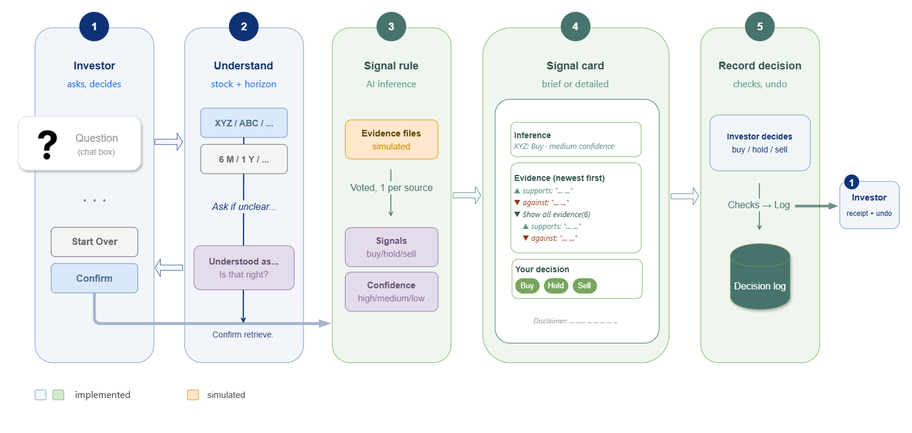

# Signal assistant

**README prose word count:** 890

A prototype decision-support assistant for retail investors. You ask about a stock; it shows what it understood, gives a Buy / Hold / Sell signal with its confidence and dated evidence, and records **your** decision. MSc Intelligent Interactive Systems, Assignment 2, University of Birmingham.

Submitted version: tag `v1.0-a2` (https://github.com/CBsbisim/signal-assistant/releases/tag/v1.0-a2)



## Project status

| Part | Status |
|---|---|
| Understanding the question, asking when unclear, "Understood as…" + Confirm | Implemented |
| Signal card: signal, confidence, dated evidence incl. one against, stale warning, no-signal | Implemented |
| Brief view by default, detailed view on request | Implemented |
| Recording the person's decision (checked, no repeats, undo) | Implemented |
| Evidence (two fictional stocks) and each item's direction | Simulated |
| Live data, a language model, horizon weighting, outcome alerts, reliance study | Planned |
| Placing real trades | Deliberately not built |

## Development record

| Change | Why | Checked |
|---|---|---|
| [5a838e8](https://github.com/CBsbisim/signal-assistant/commit/5a838e8) Lab 4 base, unchanged | already had dated sources, a stale warning and a checked tool | Lab 4 self-tests |
| [25ede46](https://github.com/CBsbisim/signal-assistant/commit/25ede46) Dated stock evidence + superseded 2025 report | Because in finance, old evidence is wrong evidence. Dated data is needed. | NAN scored 0.00 |
| [34d3395](https://github.com/CBsbisim/signal-assistant/commit/34d3395) "Understood as…" + asking | The system shows what it understood. | 4 browser cases |
| [7da3faa](https://github.com/CBsbisim/signal-assistant/commit/7da3faa) Fix: two stocks became one silently | Found in testing | New case + earlier ones |
| [8bcb30b](https://github.com/CBsbisim/signal-assistant/commit/8bcb30b) Signal card; all evidence, not top 3 | Show the signal’s bet honestly: confidence capped with few sources, one item against, so users don’t over-rely | One source gave "high" without the rule |
| [e462389](https://github.com/CBsbisim/signal-assistant/commit/e462389) Brief / detailed view | Make user understand the detail of how the inference was made | Detail changed my judgement |
| [c5265bb](https://github.com/CBsbisim/signal-assistant/commit/c5265bb) Decision recording, no trading | The investor keeps the final decision; the tool can only log it, never trade | Bad requests refused |
| [f4b2238](https://github.com/CBsbisim/signal-assistant/commit/f4b2238) 13 fixed test cases | One demo isn’t evidence; rerun the same cases after every change | 12/13; G3 in `TEST_RECORD.md` |
| [522d08c](https://github.com/CBsbisim/signal-assistant/commit/522d08c) Removed unused Lab 4 code | Unused Lab 4 code would mislead a reader about the system | 13/13 after |
| [b5d3b88](https://github.com/CBsbisim/signal-assistant/commit/b5d3b88) System diagram (fixes: [f0606cc](https://github.com/CBsbisim/signal-assistant/commit/f0606cc), [a878b32](https://github.com/CBsbisim/signal-assistant/commit/a878b32)) | Show components, flows and what is implemented or simulated | Each box checked against the code |
| [c649b44](https://github.com/CBsbisim/signal-assistant/commit/c649b44) Three storyboards | Show the person's actions, the system's responses and feedback | All screens taken from the running prototype |
| [7bb2c6a](https://github.com/CBsbisim/signal-assistant/commit/7bb2c6a) Authorship section | Separate reused, AI-assisted and my own work | Each example traced to a commit (7da3faa, f4b2238) |
| [v1.0-a2](https://github.com/CBsbisim/signal-assistant/tree/v1.0-a2) Release for submission | Finalise README, development record and links | 13/13 cases pass; all report links checked |

## Technology stack

- **Python 3 standard library only** (`http.server`, `json`, `re`, `datetime`, `uuid`). Nothing to install.
- **One HTML page with plain JavaScript** (`index.html`).
- **No AI model or API is called at run time.** The inference is a readable rule in `signal_card.py` to present the decisions made by the system clearly.
- **Undecided:** which language model would label evidence and phrase explanations, and which market-data source to use (yfinance was considered in Lab 3; it is unofficial).
- **No API keys are needed.** If a model is added later, a reviewer would supply their own key through an environment variable; no key is ever committed.

## Running or inspecting the work

Python 3.10 or later.

```
python app.py                    # then open http://localhost:8000
python run_cases.py              # the 13 fixed test cases; expect "13 of 13 passed"
python signal_card.py --selftest
python decisions.py --selftest
python retrieve.py --selftest
python signal_card.py XYZ        # print the signal card data for XYZ
```

Suggested walkthrough: click **Try: XYZ, 6 months** → **Confirm** → **Show how this signal was made** → **Sell** → **Undo**. Then try **ABC, 1 year** (only one source, so low confidence) and type `Is NAN worth buying?`.

| File | What it does |
|---|---|
| `app.py` | Web server and conversation: understanding, asking, confirming, routing decisions |
| `signal_card.py` | Evidence → signal, confidence, evidence shown, stale-source warnings |
| `decisions.py` | The one tool: records a decision after checks; undo |
| `retrieve.py` | Loads the evidence files with their source, date and direction |
| `index.html` | The page: chat, signal card, detailed view, decision buttons |
| `corpus/` | Simulated evidence, one file per source |
| `run_cases.py`, `TEST_RECORD.md` | Fixed test cases and the record of what they found |

## Authorship and AI assistance

**Reused** (first commit [5a838e8](https://github.com/CBsbisim/signal-assistant/commit/5a838e8), supplied Lab 4 prototype):
- the web server and request handling in `app.py`
- the evidence loader in `retrieve.py` (source, section, date, superseded flag)
- the page layout and chat in `index.html`
- the pattern of checking an action before running it, which `decisions.py` follows

**Assisted** (Claude, Anthropic):
- a build plan based on my A1 review and the Lab 4 code
- the draft code for the project: `app.py`, `signal_card.py`, `decisions.py`, `run_cases.py`, `index.html`,`TEST_RECOURD.md`,`README.md`
- suggestions for resonable test cases.
- explanations linking each design choice to the Week 1–4 lectures
- review of my README, system diagram and storyboards, track of AI usage and word counts

**My own work and decisions:**
- I ran, differentiated, troubleshooing and tested: `app.py`, `signal_card.py`, `decisions.py`, `run_cases.py`, `index.html`,`TEST_RECOURD.md`,`README.md`
- the evidence texts and figures in `corpus/`, and all six direction labels
- the system diagram and the three storyboards
- testing every step in the browser and running all self-tests and the 13 cases

**Examples of reviewing and changing AI output:**
- **Two stocks in one message.** My own test for the drafted code, "Is XYZ or ABC better for 1 year?", showed the code silently chose ABC without asking. I fixed this logic and re-ran the earlier cases ([7da3faa](https://github.com/CBsbisim/signal-assistant/commit/7da3faa)), so that the system ask for further confirmation.
- **Test G3.** A suggested test from AI got the system to ask for a holding period again. I decided this test was wrong in terms of improving user experience: keeping the horizon from chat history follows Amershi's G12, and it is safe because later "Understood as…" would ask for confirmation again and if user actually clicks Start over, it corrects the horizon anyway.
- **Minimum sources.** When the rule, minimum source, was removed, a single source gave "high confidence" and I tend to trust it in the brief view. So I kept the rule instead knowing that one source is not enough, and test S2 now checks it.

## Additional files

- `TEST_RECORD.md`: test results, failures found and what changed.
- `screenshots/`: the screens used in the report's storyboards.
- `docs/`: the system diagram and storyboards used in the report.
- No ZIP file; everything is in this repository.